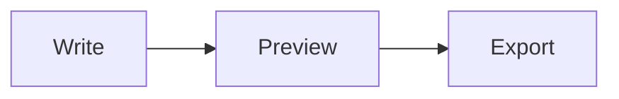

# Welcome to oMarker

Write Markdown on one side and see the **live preview** on the other. Parsing is done in Rust ([comrak](https://github.com/kivikakk/comrak)) compiled to WebAssembly; code highlighting uses highlight.js.

## Keyboard Shortcuts

| Action | Windows/Linux | macOS |
| --- | --- | --- |
| **Command Palette** (find every feature) | `Ctrl+Shift+P` | `⌘⇧P` |
| Bold/Italic | `Ctrl+B`/`Ctrl+I` | `⌘B`/`⌘I` |
| Inline code | `Ctrl+E` | `⌘E` |
| Insert link | `Ctrl+K` | `⌘K` |
| Heading 1–3 | `Ctrl+Alt+1`–`3` | `⌘⌥1`–`3` |
| Open/Save | `Ctrl+O`/`Ctrl+S` | `⌘O`/`⌘S` |
| Find and replace | `Ctrl+F` | `⌘F` |

## Supported Syntax

- [x] Tables, strikethrough (~~like this~~), autolinks: https://example.com
- [x] Task lists
- [x] Footnotes[^1]
- [x] GitHub-style alerts
- [x] Math: $E = mc^2$
- [x] Diagrams (Mermaid)

> [!TIP]
> Switch the interface language in Settings → Appearance → Language.

```rust
fn main() {
    let html = md_core::render("# Hello", &Default::default()).html;
    println!("{html}");
}
```

```ts
const result = render(markdown, { sourcepos: true });
preview.innerHTML = result.html;
```



## More Features

1. Press `Tab` in a table to move to the next cell; columns line up automatically (including CJK text)
2. Open `.txt` and `.json` files too: JSON gets a collapsible tree view and live syntax errors
3. Click a heading in the **Outline** to jump to it; the current section is highlighted
4. The preview scrolls along with the editor; drag the divider to resize
5. Your work is saved as a draft automatically, so a reload won't lose it
6. Drag files into the window to open them, or export a standalone HTML file

[^1]: Footnotes appear at the end of the document.
