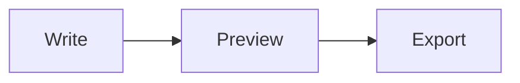

# Welcome to oMarker

This is a sample document you can edit freely. Take three minutes to read it and you'll know your way around. To start writing, press "+" at the top for a new document, or just delete this text.

## 1. Switch views

Switch between four views at the bottom of the window:

- **Live Preview** (default): see the formatted result as you type; the line with the cursor shows its Markdown source
- **Split**: Markdown on the left, preview on the right, scrolled together
- **Source** and **Preview**: just one side

## 2. Insert things

- Type `/` on an empty line to insert a table, image, task list, math, diagram, date…
- Select text to get formatting buttons, or use shortcuts: bold `Ctrl+B`, italic `Ctrl+I`, link `Ctrl+K`
- Paste a screenshot and the image is saved to an `assets` folder next to the document

## 3. Find every feature

- **Command palette** `Ctrl+Shift+P`: search any feature by name, e.g. "export", "Git", "SSH"
- **Keyboard shortcuts** `F1`
- The "⋯" menu at the top right: projects, export, Git, AI & terminal, settings

## 4. Folders and projects

- After "Open Folder", a file tree appears on the left; `Ctrl+P` opens a file quickly and `Ctrl+Shift+F` searches the whole folder
- Each folder is a project that remembers its own tabs; switch projects with the icon at the top left
- You can also edit folders on a NAS (WebDAV) or a Linux host (SSH) directly

## 5. Save, sync and export

- Saved files are saved automatically, and every save is kept in version history so you can compare and restore
- When the folder is a Git repository, `Ctrl+Shift+G` opens source control to commit and sync to GitHub in one click
- Export to PDF, Word (.docx) or HTML, or present it as a slideshow

## Supported syntax

- [x] Tables, strikethrough (~~like this~~), autolinks: https://example.com
- [x] Task lists, footnotes[^1], `[[other document]]` links, `#tags`
- [x] Math: $E = mc^2$
- [x] Diagrams (Mermaid)

| Action | Windows / Linux | macOS |
| --- | --- | --- |
| Command palette | `Ctrl+Shift+P` | `⌘⇧P` |
| Quick open | `Ctrl+P` | `⌘P` |
| Save | `Ctrl+S` | `⌘S` |
| Find and replace | `Ctrl+F` | `⌘F` |

> [!TIP]
> Bold text right next to Chinese characters is recognized correctly, with no spaces needed around the asterisks.

[^1]: Footnotes appear at the bottom of the document. You can reopen this document later with "Help: Open Welcome Document" in the command palette.
